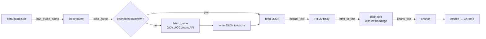

# Architecture

## Ingest pipeline (Step 1)

Solid arrows are built; dashed arrows are not built yet.

| Function | Input | Output |
|---|---|---|
| `load_guide_paths` | `data/guides.txt` | list of GOV.UK paths |
| `fetch_guide` | path | Content API JSON |
| `load_guide` | path | JSON, from the cache or fetched and then cached |
| `extract_text` | JSON | HTML body (joins `details.parts` or uses `details.body`) |
| `html_to_text` | HTML | plain text, headings as `## Title` |
| `chunk_text` | plain text, `chunk_size`, `chunk_overlap` | chunks of ≤ `chunk_size` chars: whole paragraphs packed greedily; oversized paragraphs hard-split with `split_fixed_size`; each new chunk starts with the previous chunk's last `chunk_overlap` chars (if it fits) |
